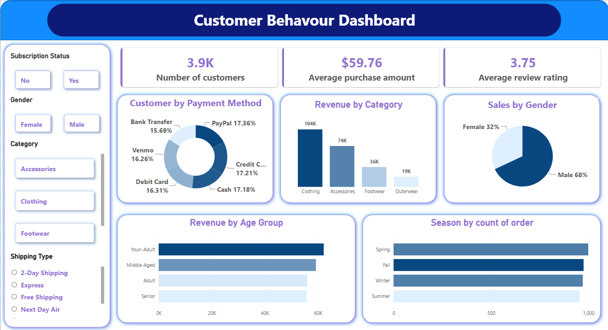

# Customer behavior - Data Analytics Project



## Overview

This project demonstrates an end-to-end **Data Analytics workflow**, starting from raw data and ending with business insights and visual reporting.

The project covers:

* Loading and exploring data using Python
* Exploratory Data Analysis (EDA)
* Data cleaning and preprocessing
* SQL analysis using PostgreSQL / MySQL / SQL Server
* Interactive dashboard development in Power BI
* Business insights and analytical reporting
* Presentation creation using Gamma

The goal is to transform raw data into **meaningful insights that support data-driven decision-making**.

---

## Dataset

The project uses a structured business dataset containing information such as:

* Customers
* Products
* Orders
* Sales
* Quantity
* Dates
* Locations
* Categories
* Other relevant business attributes

> **Dataset:** `your_dataset.csv`

---

## Tools & Technologies

| Tool                                | Purpose                                   |
| ----------------------------------- | ----------------------------------------- |
| **Python**                          | Data loading, preprocessing, and analysis |
| **Pandas**                          | Data manipulation and cleaning            |
| **NumPy**                           | Numerical operations                      |
| **Matplotlib / Seaborn**            | Data visualization                        |
| **PostgreSQL / MySQL / SQL Server** | SQL-based data analysis                   |
| **Power BI**                        | Interactive dashboard and visualization   |
| **Gamma**                           | Presentation / PPT creation               |
| **Git & GitHub**                    | Version control and project sharing       |

---

## Project Steps

### 1. Data Loading

The dataset is loaded into Python using Pandas.

```python
import pandas as pd

df = pd.read_csv("your_dataset.csv")
```

Initial checks include:

* Dataset shape
* Column names
* Data types
* Missing values
* Duplicate records
* Basic statistics

---

### 2. Exploratory Data Analysis

EDA is performed to understand the structure and behavior of the data.

Key activities include:

* Univariate analysis
* Bivariate analysis
* Distribution analysis
* Correlation analysis
* Trend analysis
* Category-wise analysis
* Outlier detection

Visualizations are created to identify patterns, trends, and anomalies.

---

### 3. Data Cleaning

The raw dataset is cleaned before performing deeper analysis.

Major cleaning activities include:

* Handling missing values
* Removing duplicate records
* Correcting data types
* Handling inconsistent values
* Detecting and treating outliers
* Standardizing categorical values
* Creating required calculated columns

The cleaned dataset is then used for SQL analysis and Power BI.

---

### 4. SQL Analysis

The cleaned data is imported into a relational database and analyzed using SQL.

SQL analysis includes:

* Filtering
* Sorting
* Aggregations
* `GROUP BY`
* `HAVING`
* `CASE WHEN`
* Joins
* Subqueries
* Common Table Expressions (CTEs)
* Window functions
* Date-based analysis

Example:

```sql
SELECT 
    category,
    SUM(sales) AS total_sales
FROM sales_data
GROUP BY category
ORDER BY total_sales DESC;
```

The SQL analysis focuses on answering practical business questions and identifying important trends.

---

### 5. Power BI Dashboard

The analyzed data is connected to Power BI to create an interactive dashboard.

The dashboard includes relevant:

* KPIs
* Charts
* Tables
* Filters
* Slicers
* Trend analysis
* Category analysis
* Geographic analysis, where applicable

The dashboard is designed to provide a quick overview of business performance and allow users to explore the data interactively.

---

### 6. Business Report

A detailed report is prepared based on the analysis.

The report covers:

* Key findings
* Important trends
* Business performance
* Customer/product insights
* Problems or unusual patterns
* Recommendations

The focus is not only on **what happened**, but also on **why it happened and what actions could be considered**.

---

### 7. Presentation

A professional presentation is created using **Gamma** to communicate the project's findings.

The presentation includes:

1. Project Overview
2. Business Problem
3. Dataset Overview
4. Data Cleaning
5. EDA Findings
6. SQL Analysis
7. Power BI Dashboard
8. Key Insights
9. Recommendations
10. Conclusion

---

## Dashboard

The Power BI dashboard provides an interactive view of the analyzed data.

**Dashboard file:** `dashboard/PowerBI_Dashboard.pbix`

Key dashboard components include:

* Total Sales
* Total Orders
* Total Quantity
* Customer/Product KPIs
* Sales trends
* Category performance
* Regional performance
* Top and bottom performers

> Add a screenshot of your Power BI dashboard here.

---

## Results & Key Insights

The analysis produces actionable insights from the dataset.

Examples of findings include:

* Identification of the highest-performing products or categories
* Identification of sales trends over time
* Identification of top-performing regions or customers
* Comparison of product/category performance
* Detection of unusual or declining business patterns
* Identification of opportunities for improvement

### Key Business Questions

The project aims to answer questions such as:

* What are the overall sales and performance trends?
* Which products or categories perform best?
* Which regions generate the most revenue?
* Who are the most valuable customers?
* How does performance change over time?
* Which areas require improvement?
* What actions can be recommended based on the analysis?

---

## Project Structure

```text
Data-Analytics-Project/
│
├── data/
│   ├── raw/
│   └── cleaned/
│
├── notebooks/
│   └── EDA_and_Data_Cleaning.ipynb
│
├── sql/
│   └── analysis_queries.sql
│
├── dashboard/
│   └── PowerBI_Dashboard.pbix
│
├── report/
│   └── Data_Analytics_Report.pdf
│
├── presentation/
│   └── Project_Presentation.pdf
│
├── requirements.txt
└── README.md
```

---

## How to Run

### 1. Clone the Repository

```bash
git clone <your-github-repository-url>
cd Data-Analytics-Project
```

### 2. Create a Python Environment

```bash
python -m venv venv
```

Activate the environment:

**Windows**

```bash
venv\Scripts\activate
```

**Linux / macOS**

```bash
source venv/bin/activate
```

### 3. Install Dependencies

```bash
pip install -r requirements.txt
```

### 4. Run the Analysis

Open the Jupyter Notebook:

```bash
jupyter notebook
```

Run:

```text
notebooks/EDA_and_Data_Cleaning.ipynb
```

### 5. Run SQL Analysis

Import the cleaned dataset into your preferred database:

* PostgreSQL
* MySQL
* SQL Server

Then execute the queries from:

```text
sql/analysis_queries.sql
```

### 6. Open Power BI Dashboard

Open:

```text
dashboard/PowerBI_Dashboard.pbix
```

Update the data source if required.

---

## Project Deliverables

| Deliverable        | Description                           |
| ------------------ | ------------------------------------- |
| Python Notebook    | EDA and data cleaning                 |
| Cleaned Dataset    | Analysis-ready data                   |
| SQL Queries        | Business-focused SQL analysis         |
| Power BI Dashboard | Interactive visualization             |
| Analytical Report  | Detailed findings and recommendations |
| Gamma Presentation | Project presentation                  |

---

## Conclusion

This project demonstrates an end-to-end approach to **data analytics**, combining Python, SQL, Power BI, and business reporting.

It showcases the ability to take raw data, clean and analyze it, answer business questions using SQL, build an interactive dashboard, and communicate insights through a professional report and presentation.

**Skills demonstrated:** Python, Pandas, EDA, Data Cleaning, SQL, PostgreSQL/MySQL/SQL Server, Power BI, Data Visualization, Business Analysis, and Data Storytelling.
